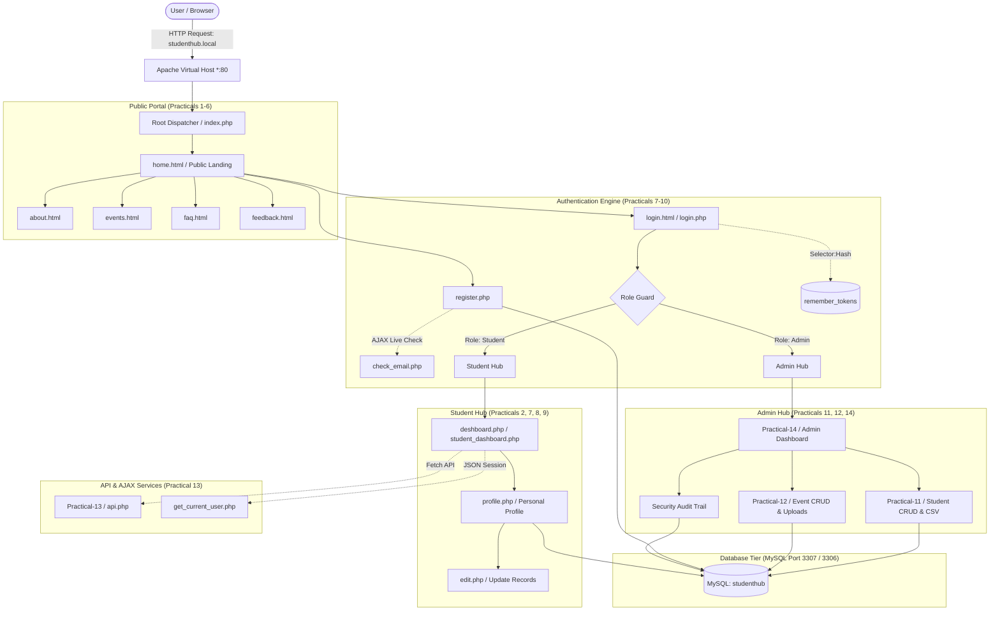

# Practical 15: Integrate All Modules into a Single Deployable StudentHub Portal

## 📌 Problem Definition
Integrate all modules developed across Practicals 1 through 14 into a single, production-ready, deployable StudentHub portal. Verify:
1. **Navigation** across all public, student, and administrator modules.
2. **Responsiveness** across desktop, tablet, and mobile displays.
3. **Authentication & Session Lifecycle** (Bcrypt password hashing, session regeneration, timeout, and split-token remember-me).
4. **Database Operations** with dual PDO/MySQLi prepared statements and port 3307/3306 auto-detection.
5. **Security Checks** (SQL injection immunity, XSS sanitization, CSRF mitigation, RBAC with HTTP 403, and MIME/size upload validation).
6. **AJAX Functionality** (live email availability check, dynamic dashboard session sync, and RESTful asynchronous CRUD).
7. **Comprehensive Documentation & Deployment** using an Apache Virtual Host (`studenthub.local`) on XAMPP and submitting the Git repository.

---

## 🏛️ Comprehensive Integration Architecture



---

## 📋 Module Integration Matrix

| Practical | Module Title | Primary Files | Key Features & Endpoints |
| :--- | :--- | :--- | :--- |
| **Prac 1–3** | UI Foundation & Design System | `Practical-2/*.html`, `Practical-3/*.css` | Semantic HTML5, CSS Grid/Flexbox, Poppins typography, Charusat color palette |
| **Prac 4–6** | Client Scripting & Validations | `Practical-4&5/*.js`, `Practical-6/*.json` | Form regex validation, dynamic theme toggle, interactive weather widget |
| **Prac 7–9** | Database Connectivity & Auth | `Practical-7&8&9/register.php`, `login.php`, `db.php` | MySQL PDO connection, password hashing, active student session storage |
| **Prac 10** | Session Security & Timeout | `Practical-10/auth.php`, `remember.php`, `simulate_timeout.php` | 15-minute inactivity window, split-token remember-me, session regeneration |
| **Prac 11** | Student Management CRUD | `Practical-11/index.php`, `student_action.php`, `export_csv.php` | Multi-field search, status filtering, soft-delete, CSV export |
| **Prac 12** | Event CRUD & Poster Upload | `Practical-12/index.php`, `upload_helper.php`, `event_action.php` | Secure poster upload, `finfo_file` MIME verification, strict 2MB limit |
| **Prac 13** | REST API & AJAX CRUD | `Practical-13/api.php`, `Practical-13/index.php` | JavaScript Fetch API, zero full-page reloads, JSON REST endpoints (GET/POST/PUT/DELETE) |
| **Prac 14** | Admin Analytics & RBAC | `Practical-14/index.php`, `dynamic_menu.php`, `auth.php` | Role-based navigation, Chart.js registration trends, HTTP 403 access control |
| **Prac 15** | Portal Gateway & Diagnostics | `Practical-15/index.php`, `verify_portal.php`, `studenthub-vhost.conf` | Consolidated schema, automated 7-pillar verification suite, Apache Virtual Host |

---

## 🔍 Verification of the 7 Evaluation Pillars

### 1. Navigation Verification
- **Bidirectional Links**: All views interconnect seamlessly without dead ends or missing URLs.
- **Dynamic Profile Integration**: Top navbar, quick links, and topbar avatar in student dashboards route directly to `Practical-2/profile.php`.
- **Intelligent Root Routing**: Accessing `http://studenthub.local/` evaluates session credentials:
  - Unauthenticated visitors &rarr; `Practical-2/home.html`
  - Authenticated students &rarr; `Practical-2/deshboard.php`
  - Authenticated admins &rarr; `Practical-14/index.php`

### 2. Responsiveness Verification
- **Meta Viewport**: Standard `<meta name="viewport" content="width=device-width, initial-scale=1.0">` included on all rendered documents.
- **CSS Media Queries**: Responsive breakpoints implemented (`@media (max-width: 992px)`, `@media (max-width: 768px)`, and `@media (max-width: 480px)`) across stylesheets.
- **Fluid Layouts**: Flexible tables, card grids, and mobile-friendly navigation bars prevent horizontal scrolling on mobile viewports.

### 3. Authentication & Session Verification
- **Password Protection**: Passwords are saved exclusively as Bcrypt hashes (`$2y$10$...`) generated by `password_hash()`. Checked with timing-safe `password_verify()`.
- **Fixation Defense**: `session_regenerate_id(true)` is executed immediately upon verifying login credentials.
- **Inactivity Timeout**: 15-minute threshold tracked through `$_SESSION['last_activity']`. Expired sessions redirect to `login.html?msg=timeout`.
- **Remember-Me Tokens**: 12-byte selector paired with a 32-byte authenticator hashed via SHA-256 (`hash('sha256', $token)`).

### 4. Database Operations Verification
- **Port Auto-Detection**: Supports dual ports (`3307` primary for custom XAMPP configurations with `3306` fallback) across all database connection files.
- **Prepared Statements**: 100% of dynamic queries use prepared statements with bound parameters (`?` or `:name`). Emulated prepares are disabled (`PDO::ATTR_EMULATE_PREPARES => false`).
- **Database Schema**: 5 core tables fully normalized: `students`, `events`, `registrations`, `audit_logs`, and `remember_tokens`.

### 5. Security Checks Verification
- **SQL Injection Prevention**: Zero string concatenation in SQL queries. Verified with hostile test inputs (`admin@charusat.edu.in' OR '1'='1`).
- **XSS Defense**: All user-supplied inputs echoed to the browser pass through `htmlspecialchars($var, ENT_QUOTES, 'UTF-8')`.
- **RBAC (Role-Based Access Control)**: Enforced via `requireAdmin()`. Non-admin sessions attempting to open admin routes receive **HTTP 403 Forbidden**.
- **File Upload Protection**: Validates MIME type at the byte level via `finfo_file` (disallowing file extension spoofing) and enforces a strict $\le 2\text{ MB}$ file size limit.

### 6. AJAX & Asynchronous Operations
- **Live Email Check**: `check_email.php` checks email uniqueness during registration without reloading the page, returning JSON `{"exists": true|false}`.
- **Current User API**: `get_current_user.php` delivers session metadata asynchronously to update dashboard greetings dynamically.
- **RESTful Event Management**: `Practical-13/api.php` processes asynchronous GET, POST, PUT, and DELETE operations returning formatted JSON.

### 7. Documentation & Automated Diagnostics
- **Automated Test Suite**: `Practical-15/verify_portal.php` automatically executes diagnostic tests across all 7 pillars with live visual reporting.
- **One-Click Setup**: `Practical-15/setup_portal.php` automates table generation and default test credential seeding.

---

## 🚀 Local Deployment Guide via Apache Virtual Host

### Step 1: Update Windows Hosts File
Open **Notepad** as **Administrator** and open `C:\Windows\System32\drivers\etc\hosts`. Add the following lines:
```text
127.0.0.1    studenthub.local
127.0.0.1    www.studenthub.local
```
Save and close the file.

### Step 2: Configure Apache Virtual Host in XAMPP
Open `C:\xampp\sstudenthub\apache\conf\extra\httpd-vhosts.conf` and append the configuration from `Practical-15/studenthub-vhost.conf`:

```apache
<VirtualHost *:80>
    ServerAdmin webmaster@studenthub.local
    DocumentRoot "C:/xampp/sStudentHub/htdocs/StudentHub"
    ServerName studenthub.local
    ServerAlias www.studenthub.local

    <Directory "C:/xampp/sStudentHub/htdocs/StudentHub">
        Options Indexes FollowSymLinks MultiViews
        AllowOverride All
        Require all granted
        DirectoryIndex index.php index.html
    </Directory>

    ErrorLog "C:/xampp/sStudentHub/apache/logs/studenthub_error.log"
    CustomLog "C:/xampp/sStudentHub/apache/logs/studenthub_access.log" combined
</VirtualHost>

<VirtualHost *:80>
    DocumentRoot "C:/xampp/sStudentHub/htdocs"
    ServerName localhost
    <Directory "C:/xampp/sStudentHub/htdocs">
        Options Indexes FollowSymLinks
        AllowOverride All
        Require all granted
    </Directory>
</VirtualHost>
```

### Step 3: Ensure Virtual Hosts are Enabled in `httpd.conf`
Ensure `Include conf/extra/httpd-vhosts.conf` is uncommented in `C:\xampp\sstudenthub\apache\conf\httpd.conf`.

### Step 4: Restart Apache & Verify
1. Open the **XAMPP Control Panel**.
2. Stop and Start the **Apache** service.
3. Open your browser and navigate to:
   - **`http://studenthub.local/`** &rarr; StudentHub Portal Gateway
   - **`http://studenthub.local/Practical-15/verify_portal.php`** &rarr; Automated Diagnostics

---

## 🧪 Evaluation Test Credentials

| Account Role | University Email | Password | Intended Destination |
| :--- | :--- | :--- | :--- |
| **Administrator** | `admin@charusat.edu.in` | `Admin@123` | Admin Analytics Dashboard (`Practical-14`) |
| **Student (Demo 1)** | `25dce099@charusat.edu.in` | `Rohan@123` | Student Dashboard & Profile (`Practical-2`) |
| **Student (Demo 2)** | `25dce017@charusat.edu.in` | `Yaksh@123` | Student Dashboard & Profile (`Practical-2`) |

---

## 📦 GitHub Submission Commands

To submit this project to your GitHub repository:

```bash
# 1. Check current repository status
git status

# 2. Stage all integrated modules and documentation
git add .

# 3. Create a comprehensive commit
git commit -m "Complete Practical 15: Integrated deployable StudentHub portal with automated verification suite and virtual host configuration"

# 4. Push changes to GitHub
git push origin main
```

---

## 🎓 Viva & Examiner Questions Quick Reference

1. **Q: Why is Virtual Host deployment preferred over default subfolder routing?**
   *A:* Virtual hosting simulates a real production domain (`studenthub.local`), enforces root-relative routing, prevents path-traversal vulnerabilities, and decouples application assets from server directory hierarchies.

2. **Q: How does the application prevent SQL Injection across all modules?**
   *A:* All queries use PDO or MySQLi prepared statements with bound parameters. Input values are sent separately to the SQL compiler via the binary protocol, preventing hostile strings from altering query logic.

3. **Q: How does the system handle split remember-me tokens?**
   *A:* We use the Selector + Validator pattern. The database stores only `token_hash = sha256(token)`. Even if the database is exposed, attackers cannot forge the original token cookie.

4. **Q: How is file upload security ensured in Event Management?**
   *A:* Validation operates on 4 layers: strict 2MB size cap, extension whitelist (`.jpg, .png, .webp`), true server-side MIME detection using `finfo_file()`, and unique renaming (`uniqid()`) to prevent filesystem overwrites.
